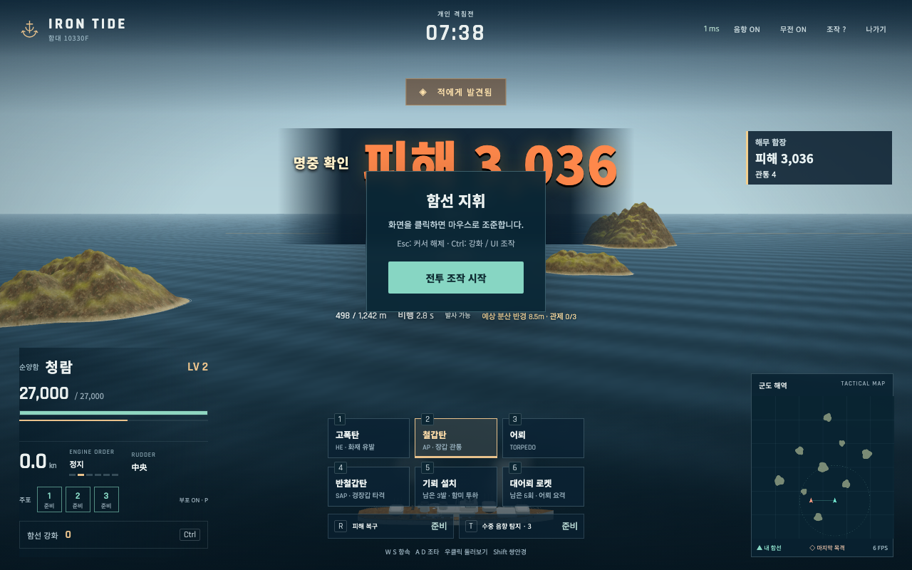

# IRON TIDE · 철의 해역

브라우저에서 함선을 직접 조종하고 섬 사이로 기동하며 포격·어뢰·기뢰로 상대를 격침하는 **3인칭 온라인 전술 해전 게임**입니다. 플레이어와 NPC를 합쳐 2–4척이 참가하며, 혼자 NPC와 출항할 수도 있습니다.

월드 오브 워쉽의 항해 관성, 포탑별 사격, 탄종·장갑, 은폐·탐지, 쌍안경 조준에서 영감을 받았습니다. 독자적인 군도 지도와 함종·경기 중 성장 규칙을 사용합니다. 아래 내용은 현재 코드에 반영된 최종 설계와 구현 범위입니다.



## 실행과 참가

**Node.js 22.12 이상**이 필요합니다.

```sh
npm install
npm run dev
```

- 게임: <http://localhost:5173>
- 서버 상태: <http://localhost:3000/health>
- 친구와 플레이: **새 함대 창설 → 6자리 코드 공유 → 참가자별 함종 선택·출항 준비 → 함대장 출항**.
- 혼자 플레이: **새 함대 창설 → NPC 함종·모델 선택 → NPC 추가 → 출항 준비 → 출항**. NPC는 자동으로 준비합니다.
- 함대장은 출항 전에 NPC를 추가·제외할 수 있습니다. 사람과 NPC를 합쳐 최대 4척이며 최소 2척부터 시작합니다.
- 같은 PC에서는 서로 다른 브라우저 프로필이나 시크릿 창을 사용하세요. 재접속 정보는 탭별 `sessionStorage`에 저장합니다.
- 같은 Wi-Fi/LAN에서는 터미널에 표시되는 `Network` 주소를 사용합니다. 방 코드만으로 다른 네트워크에 있는 서버에 접속하지는 못합니다.

### 프로덕션 모드

```sh
npm run build
npm start
```

<http://localhost:3000>에서 빌드한 화면과 WebSocket을 함께 제공합니다. `PORT`로 서버 포트를 바꿀 수 있습니다. 개발 모드에서 별도 서버 포트를 쓰면 Vite의 `API_PORT`도 맞춰야 합니다.

방과 경기는 메모리에 저장하므로 서버를 재시작하면 사라집니다. GitHub 저장소에 소스와 자산을 보관하며, 외부 게임 서버 배포는 별도입니다.

## 경기 흐름과 승리 조건

1. 출항 전에 구축함·순양함·전함 중 하나를 선택합니다. 경기 중 함종은 바꿀 수 없습니다.
2. **8분 개인전**에서 섬을 엄폐물로 사용하고 상대의 항로·재장전·노출 측면을 읽어 공격합니다.
3. 격침 수로 순위를 정하고 동점이면 실제 누적 피해량을 비교합니다. 결과 화면에서 피해량·명중률·레벨 등도 확인합니다.
4. 침몰하면 **5초 후 재출격**, **3초간 보호**됩니다. 발사하면 보호가 해제됩니다.
5. 경기 중 얻은 레벨과 강화는 재출격해도 유지됩니다. 다음 경기는 성장을 초기화하고 선택한 함종을 유지합니다.

전투는 정지한 두 배가 같은 거리에서 포탄만 교환하는 방식이 아닙니다. 조준으로 거리와 포신 고각을 바꿀 수 있고, 함선은 관성 때문에 감속·회피에 시간이 걸립니다. 구축함의 은폐 기습, 섬 너머 곡사, 전함의 장갑 각도, 어뢰 진로 유도, 연막·음향 탐지, 기뢰와 수동 요격을 조합합니다.

## 조작과 카메라

화면의 **전투 조작 시작**을 누르면 마우스로 시야와 조준을 조작합니다. 브라우저가 마우스 잠금을 제한하면 창 안의 마우스 이동을 사용하는 대체 입력으로 전환합니다. 한글 입력 상태에서도 물리 키 위치를 기준으로 조작합니다.

| 입력                          | 동작                                             |
| ----------------------------- | ------------------------------------------------ |
| W / S                         | 항속 단계 올리기 / 내리기. 길게 누르면 연속 변경 |
| A / D                         | 누르는 동안 좌현 / 우현 조타                     |
| Q / E                         | 지속 조타. 반대 방향 지속 조타 키로 해제         |
| 마우스                        | 함선 주변 시야 회전·상하 조준, 포탑 추적         |
| 우클릭 유지                   | 기존 주포 조준점을 유지하고 주변 둘러보기        |
| 휠                            | 3인칭 카메라 확대·축소                           |
| Shift                         | 쌍안경 정밀 조준 켜기 / 끄기                     |
| X                             | 조준 방향에 가까운 탐지 표적 지정                |
| 1 / 2 / 3                     | 고폭탄 / 철갑탄 / 어뢰 선택                      |
| 4 / 5 / 6                     | 반철갑탄 / 기뢰 / 대어뢰 로켓 선택               |
| 클릭 / 더블클릭 / 길게 누르기 | 포탑 하나 발사 / 일제사격 / 순차 사격            |
| R                             | 피해 복구: 화재·침수 제거와 잠시 면역            |
| T                             | 구축함 연막 / 순양함 음향 탐지 / 전함 수리반     |
| P                             | 부포 자동 사격 켜기 / 끄기                       |
| Ctrl                          | 커서 해제·강화 패널                              |
| Tab                           | 전투 점수판                                      |
| Esc                           | 마우스 조작 해제·패널 닫기                       |

3인칭 카메라는 함선 주변을 회전하고 거리를 조절합니다. Shift는 망원 시야로 전환하며 **같은 수면 조준 좌표를 유지**합니다. 휠 확대·축소도 조준 좌표를 유지합니다. 일반 시점에서 쏜 뒤 Shift로 확대해 포탄과 착탄을 관찰할 수 있으며, 시점 전환은 이미 발사한 포탄의 궤적을 바꾸지 않습니다.

강화 화면을 닫은 뒤 다시 **전투 조작 시작**을 누르세요. 패널을 열어도 전투와 함선 이동은 계속됩니다.

### 항해·좌초와 탈출

항속은 **후진 → 정지 → ¼ → ½ → ¾ → 전속**의 6단계입니다. W/S를 놓아도 선택한 단계가 유지되며, 실제 속력은 가속·감속 관성에 따라 변합니다. 후진 최고속력은 전진의 30%입니다. 전함은 구축함보다 가속과 선회가 느리므로 미리 항로를 잡아야 합니다.

해안 접촉 시 경고와 서버가 받아들인 기관 명령을 표시합니다. **S를 길게 눌러 후진 단계까지 내리고 A/D로 탈출 방향을 잡으세요.** 해안 안쪽으로 파고드는 이동만 제한하고 해안선을 따라 움직이거나 바깥으로 빠지는 이동은 유지합니다. 접촉 중에도 기관이 작동하면 낮은 속력에서 조타할 수 있고, 해안 안으로 겹친 선체는 바깥으로 복구합니다.

## 함종과 기본 성능

아래 수치는 게임 밸런스 값입니다. 거리·구경 표기는 게임 내 단위이며 역사적 실함의 제원이나 실물 속력 환산을 뜻하지 않습니다.

| 항목                    | 구축함 · 해무      | 순양함 · 청람      | 전함 · 태산        |
| ----------------------- | ------------------ | ------------------ | ------------------ |
| 역할                    | 은폐·어뢰 기습     | 다목적 포격·탐지   | 중장갑·대구경 포격 |
| 체력                    | 14,000             | 27,000             | 50,000             |
| 최고 이동 속력 설정     | 28                 | 22                 | 16                 |
| 길이 / 폭               | 44 / 7m            | 59 / 10m           | 76 / 15m           |
| 기본 피탐지 거리        | 530m               | 740m               | 940m               |
| 주포                    | 127mm, 2연장 × 2기 | 203mm, 3연장 × 3기 | 380mm, 3연장 × 3기 |
| 기본 주포 사거리        | 900m               | 1,150m             | 1,350m             |
| 주포 재장전             | 4초                | 7초                | 12초               |
| 포탄 기본 피해 설정     | 1,200              | 2,300              | 4,400              |
| 선수 / 측면 / 갑판 장갑 | 13 / 19 / 13mm     | 25 / 100 / 30mm    | 32 / 260 / 50mm    |
| 어뢰 피해 / 재장전      | 7,500 / 24초       | 6,500 / 32초       | 없음               |
| 어뢰 사거리             | 1,150m             | 850m               | 없음               |
| 부포 사거리             | 없음               | 290m               | 390m               |
| 특수 장비               | 연막 생성기        | 수중 음향 탐지     | 수리반             |

포탄 기본 피해는 장갑 판정 전 설정값입니다. 실제 체력 피해는 탄종·관통·과관통·핵심 구획·남은 체력 등에 따라 달라집니다. 함종·성장·지형의 공통 설정은 [`shared/config.ts`](shared/config.ts)에 있습니다.

## 조준·탄도와 착탄 분산

마우스 상하 조준으로 수면 목표 거리와 포신 고각을 함께 바꿉니다. 거리를 맞추기 위해 함선을 이동할 필요는 없습니다. 포탄은 서버에서 중력과 비행 시간을 적용해 이동하며 이동 표적에는 앞을 예측해 쏴야 합니다. 섬이나 함선에 먼저 부딪히면 그 지점에서 판정합니다.

수면의 **예상 착탄 원**은 서버가 사용하는 분산 반경을 표시합니다. 포탄은 원 안에서 면적에 균등한 확률로 떨어집니다. 원은 피해 범위나 확정 명중 영역이 아니며 표적이 움직이거나 중간에 지형이 있으면 빗나갈 수 있습니다.

- 함종별 기준 분산 반경은 구축함 8m, 순양함 11m, 전함 16m입니다.
- 거리가 멀어질수록 원이 커지고 **최대 사거리의 55%**를 넘으면 증가가 더 가팔라집니다. 이 지점이 최소 분산 거리를 뜻하지는 않으며 가까운 사격의 원이 더 작습니다.
- HE는 기본 분산의 1.12배, AP는 1배, SAP는 0.9배입니다.
- 정확도 강화는 단계마다 기본 반경을 12%씩 줄입니다. 3단계에서는 36% 줄어듭니다.
- 일제 확장은 포탄 수를 늘리는 대신 분산을 단계마다 15% 넓힙니다.
- 강화된 사거리와 무기 종류를 반영하며 사거리 밖 조준은 유효 사거리로 제한합니다.

포탑은 각자 회전 속도·사격 가능 각도·재장전 상태를 가집니다. 선체에 가려진 방향이나 회전이 끝나지 않은 포탑은 즉시 쏠 수 없습니다. HE/AP/SAP를 바꾸면 주포 재장전을 다시 시작합니다. 어뢰·기뢰·RBU로 전환하는 것은 장전된 주포 탄종을 초기화하지 않습니다.

## 무장

| 무장                    | 사용과 특징                                                                              |
| ----------------------- | ---------------------------------------------------------------------------------------- |
| **1 · HE 고폭탄**       | 경장갑과 화재 유발용. 장갑 두께에 따라 관통 여부를 판정                                  |
| **2 · AP 철갑탄**       | 입사각·장갑·구경 우세를 고려. 관통·도탄·비관통·과관통·핵심 구획 구분                     |
| **3 · 어뢰**            | 구축함·순양함이 측면 발사 각도에서 3발 발사. 안전 거리 이후 신관 작동, 명중 시 침수 가능 |
| **4 · SAP 반철갑탄**    | 경장갑 타격용. 화재·과관통·핵심 구획 판정이 없고 두꺼운 장갑과 큰 입사각에 약함          |
| **5 · 기뢰**            | 함미에 투하. 적의 예상 항로와 좁은 수로를 차단                                           |
| **6 · RBU 대어뢰 로켓** | 접근하는 어뢰 앞 수역을 직접 조준해 6발 발사. 착수 폭발로 적 어뢰·기뢰 제거              |
| **자동 부포**           | 순양함·전함이 사거리 안의 탐지된 적에게 자동 사격. P로 전환                              |

### 기뢰와 대어뢰 방어

**기뢰:** 출격당 3발, 설치 간격 6초, 설치 후 2초에 무장, 수명 90초, 기본 피해 6,000, 폭발 반경 22m입니다. 설치자에게는 피해를 주지 않습니다. 자신이 설치한 기뢰는 보이며 적의 기뢰는 110m 근접 탐지 또는 음향 탐지 등 탐지 조건에 따라 보입니다.

**RBU:** 출격당 6회, 재사용 10초, 최대 사거리 240m입니다. 6발이 시간차로 날아가 착수 지점 주변 22m의 적 어뢰·기뢰를 제거하고 함선에는 작은 범위 피해를 줍니다. 자동 추적 포탑이 아니므로 어뢰의 접근 방향과 로켓 도달 시간을 읽어 수역을 선점해야 합니다. 자신의 어뢰·기뢰는 제거하지 않습니다.

기뢰·로켓 탄수는 재출격 때 보충합니다. 설치자당 동시에 유지하는 기뢰는 최대 3개이며 추가 설치 시 가장 오래된 것을 교체합니다. 기존 기뢰는 수명·폭발·경기 초기화 규칙에 따라 정리합니다.

## 충돌·장갑과 명중 피드백

서버가 포탄의 이전 위치부터 다음 위치까지 **연속 3D 구간**으로 가장 먼저 접촉한 표면을 찾습니다. 단순히 선체 외곽 사각형 안에 들어왔다는 이유만으로 명중시키지 않습니다.

- 플레이어 함선의 곡면 선체와 갑판은 렌더링과 충돌이 같은 기하 정의를 공유합니다. 상부 구조물·추가 포탑은 별도 단순 충돌체입니다.
- NPC는 제공된 원본 GLB의 노드 변환·삼각형을 읽고 화면과 같은 회전·크기·수면 높이로 정규화합니다. BVH로 표면 교차를 찾습니다.
- 접촉점의 법선과 선수·함미·측면·갑판·상부 구조물·포탑 부위를 장갑 판정에 사용합니다. 상부 구조물에 중장갑 측면 수치를 일괄 적용하지 않습니다.
- AP는 입사각과 얇은 장갑에 대한 구경 우세를 반영합니다. 순양함·전함의 핵심 구획과 과관통을 구분합니다. 실제 표면에 맞아도 도탄·비관통이면 체력 피해가 없을 수 있습니다.
- 파도의 작은 시각적 흔들림, 모든 난간·장식·추가 포신까지 물리적으로 복제하지는 않습니다.

**명중 확인과 피해를 분리**합니다. 조준점 명중 마커, 대상 근처의 피해 숫자, 일제사격 합계, 최근 명중 기록을 함께 표시하고 관통·과관통·핵심 구획·도탄·장갑 비관통·재출격 보호 사유를 구분합니다. 장갑 판정에는 접촉 부위·두께·입사각도 표시합니다.

피해 숫자는 **72px**, 등장 시 확대 연출을 적용하고 **3초간 유지**합니다. 추가 피해는 기존 숫자를 지우지 않고 **그 위에 중첩**합니다. 같은 순간의 같은 판정만 합산하며, 피해량에 따라 연노랑·주황·빨강으로 구분합니다. 큰 피해와 핵심 구획 명중은 더 강하게 강조합니다. 피해 없는 명중은 별도의 작은 문구로 나타냅니다.

## 지형·은폐와 탐지

군도는 9개 섬과 불규칙한 해안·능선으로 구성합니다. 화면과 서버가 같은 해안·지형 함수를 사용합니다. 섬은 이동과 일반 시야를 막지만 충분히 높은 탄도의 포탄은 섬 위로 날아갈 수 있습니다.

- 기본 피탐지 거리는 함종마다 다릅니다. 주포 발사 후 **20초간** 피탐지 거리가 현재 주포 사거리까지 늘어납니다.
- 화재는 노출을 늘립니다. 연막은 양방향 시야를 제한하지만 연막 안 발포에는 별도의 노출 규칙이 있습니다.
- **100m 이내 강제 탐지**와 순양함의 **430m 음향 탐지**가 있습니다. 음향 탐지는 섬·연막 뒤의 가까운 표적도 드러냅니다.
- 표적을 놓치면 현재 좌표 대신 마지막 목격 위치를 미니맵에 표시합니다.
- 서버는 미탐지 적의 현재 좌표·체력·레벨을 상대에게 전달하지 않습니다.

## 피해 복구와 함종별 장비

**R · 피해 복구:** 화재·침수를 제거하고 5초간 면역을 부여합니다. 재사용 45초이며 체력을 직접 회복하지 않습니다.

**T · 특수 장비:** 함종마다 3회 사용할 수 있고 재사용 60초입니다.

| 함종   | 특수 장비                                          |
| ------ | -------------------------------------------------- |
| 구축함 | 12초간 연막을 생성. 각 연막은 반경 100m, 32초 유지 |
| 순양함 | 25초간 수중 음향 탐지                              |
| 전함   | 20초간 회복 가능한 피해를 수리                     |

수리반은 모든 피해를 원상 복구하지 않습니다. 화재·침수 피해는 100%, 일반 피해는 50%, 핵심 구획 피해는 10%를 회복 가능량으로 적립하며 그 범위 안에서 회복합니다.

## 경기 중 성장과 강화

실제 입힌 피해량만큼 경험치를 얻고 격침 시 500, 격침자가 아닌 참가자가 표적 최대 체력의 10% 이상 피해를 기여하면 250의 추가 경험치를 받습니다. 다음 레벨 필요 경험치는 `1,600 + (현재 레벨 - 1) × 900`이며 최고 **레벨 10**, 레벨업마다 강화 포인트 1점입니다.

각 강화는 최대 3단계입니다. 수치는 단계당 기본값 대비 변화이며 다른 종류의 강화 효과는 함께 적용됩니다.

| 강화               | 효과                                     |
| ------------------ | ---------------------------------------- |
| 사격 관제 · 정확도 | 주포 분산 반경 −12%, 3단계에서 −36%      |
| 주포 사거리        | 사거리 +8%. 발포 피탐지 거리도 증가      |
| 일제사격 포탄 수   | 포탑당 포탄 +1, 분산 +15%, 포탄 피해 −8% |
| 주포 재장전        | 재장전 시간 −7%                          |
| 부포 성능          | 사거리 +10%, 재장전 시간 −10%            |
| 어뢰 성능          | 속도 +8%, 재장전 시간 −6%                |
| 기관과 조타        | 최고속력 +5%, 가속·선회 +6%              |

침몰해도 레벨·강화는 유지하고 다음 경기에서 초기화합니다. 장비가 없는 함종은 해당 무장 강화에 제한이 있습니다.

## NPC와 사용자 제공 함선

NPC는 일반 플레이어와 같은 서버 규칙으로 이동·탐지·피해·재장전·재출격·강화를 처리합니다. 섬과 경계를 피해 항로를 탐색하고, 탐지한 적에게 예측 포격·어뢰 공격을 하며 위협을 회피합니다. 특수 장비, 근접 기뢰, 대어뢰 로켓도 사용합니다. 미탐지 적 좌표를 조준 정보로 사용하지 않습니다.

NPC 외형은 다음 두 사용자 제공 GLB를 사용합니다. 원본 재질을 유지하고 수면 높이·선수 방향·함종별 크기를 조절하며 별도로 회전·반동하는 포탑을 추가합니다.

| 선택 항목        | 포함 파일과 특징                                                                                                                                          |
| ---------------- | --------------------------------------------------------------------------------------------------------------------------------------------------------- |
| 위장 함선        | `public/models/npc-battleship.glb` — `Meshy_AI_Camouflaged_Battleshi_1017161035_texture.glb` 원본. 함종별 크기로 적용                                     |
| Wisconsin Golden | `public/models/npc-wisconsin-golden.glb` — `Meshy_AI_Golden_Leviathan_1017162031_texture.glb` 원본. 전함으로 제한, **406mm 3연장 포탑 3기·기본 일제 9발** |

Wisconsin Golden은 사용자가 지정한 [동명 함선 참고 항목](https://asia.wows-numbers.com/ko/ship/3309254640,Wisconsin-Golden/)을 반영한 별도 NPC 선택입니다. 다른 전투 수치는 이 게임의 전함 밸런스를 사용합니다. 사용자 제공 GLB는 아래 CC0 외부 효과음·재질과 별도의 자산입니다. 플레이어는 게임 자체 모델을 사용합니다.

## 시각·침몰 연출

플레이어 함선은 곡면 선체, 목재 갑판, 함교 창, 난간·마스트·장비와 포탑을 갖춥니다. 섬은 연속적인 능선과 해안에 사진 기반 암벽·모래·식생 재질을 혼합합니다. 수면 셰이더와 항적·선수 물살을 사용합니다.

포탄에는 탄체와 짧은 예광 궤적, 발사 시 포구 화염·포연·포탑 반동을 적용합니다. 착수는 구경에 따른 물기둥·물방울·안개·확장 파문으로 표현합니다. 함선 명중 시 피해에 비례해 화염·파편·검은 연기를 강화하며, 도탄·비관통은 별도의 불꽃으로 표현합니다.

최종 침몰은 폭발 후 **원본 선체를 중앙에서 두 부분으로 나눠** 파손 단면과 내부 골조를 드러냅니다. 두 부분이 독립적으로 벌어지고 기울며 내려가고 갑판 화염·연기·증기를 더합니다. GLB의 원래 외형과 재질도 유지합니다. 약 **13초간** 진행하는 시각 연출이며 재출격 5초 규칙과 독립적입니다. GPU 클리핑·애니메이션 방식이며 물리적인 선체 파괴·유체 해석은 아닙니다.

## 엔진·무기 음향과 무전

대기실의 **주포 시연 · 음향 듣기**에서 포탑 반동·포연·탄도와 포성을 미리 확인할 수 있습니다. 음량 슬라이더와 전체 음향 ON/OFF, 무전 ON/OFF를 제공합니다. 브라우저 오디오 활성화를 위해 사용자 클릭이 필요합니다.

- **포성:** 실제 함포·대포·폭발 녹음을 섞고 저음과 잔향을 적용합니다. 거리별 감쇠·필터·전파 지연과 좌우 위치를 반영하고 출력 리미터를 사용합니다.
- **항해음:** 실제 속력·기관 부하에 따라 엔진음의 높이·음량이 변하며 속력이 붙으면 선수 물살이 커집니다. 후진도 반영하고 침몰·퇴실·접속 단절 시 잦아듭니다.
- **어뢰:** 압력 방출과 3발의 입수음을 별도로 재생합니다. 실제 어뢰 녹음 대신 압력·물소리 Foley를 사용합니다.
- **착수:** 실제 물소리 녹음과 저음·거리 감쇠를 물기둥에 맞춰 재생합니다.
- **무전:** 가속·감속·정지·후진·좌현·우현·키 중앙 명령에 한국어 남성 음성과 자막을 사용합니다. `ko-KR-InJoonNeural`로 미리 생성한 12개 WAV에 무전 대역 필터·압축·약한 잡음·송수신음을 적용했습니다. 배우나 실제 군 교신 녹음은 아닙니다.
- 키를 유지해도 같은 무전을 반복 호출하지 않습니다. 빠르게 바꾼 명령은 기관·조타별 최신 명령으로 정리하며 음성이 겹치지 않도록 순서대로 재생합니다.

모든 재질·GLB·녹음·무전은 로컬 파일로 제공합니다. 플레이 중 외부 음성 API나 운영체제 TTS를 호출하지 않습니다.

## 온라인 구조와 연결 처리

TypeScript와 Three.js/Vite 프런트엔드, Node.js/WebSocket 서버를 사용합니다. 서버가 **30Hz**로 시뮬레이션하고 참가자별 필터링한 상태를 **15Hz**로 전송합니다. 피해·충돌·장갑·탐지·경험치·강화·무장 사용 가능 여부는 서버가 판정합니다.

재접속 토큰은 서버가 무작위로 발급하며 공개 점수판에 넣지 않습니다. 연결이 끊겨도 함선은 기존 항속·조타를 유지하고 공격받을 수 있습니다. **30초 안에** 자동 재연결이나 새로고침으로 복귀할 수 있습니다. 함대장이 나가면 연결된 사람 참가자에게 권한을 넘깁니다. 사람이 없는 방은 정리하며 NPC가 함대장이 되지는 않습니다. 이름 등 외부 문자열은 화면에 표시할 때 HTML 이스케이프합니다.

## 프로젝트 구성과 자산

| 경로                    | 내용                                              |
| ----------------------- | ------------------------------------------------- |
| `client/`               | 3D 화면·UI·입력·음향·명중 피드백·침몰 연출        |
| `server/`               | 방·세션·서버 전투·NPC·GLB 표면 충돌               |
| `shared/`               | 타입·함종·성장·탄도·조준·선체·지형·항해 공통 규칙 |
| `public/`               | 실행에 필요한 GLB·사진 재질·효과음·무전           |
| `assets/source/`        | 자산 원본·무전 생성 캐시                          |
| `assets/ATTRIBUTION.md` | 출처·라이선스·가공 방법·GLB 원본 해시             |
| `scripts/`              | 효과음 가공과 무전 생성 도구                      |
| `tests/`                | 단위·WebSocket 통합·실제 브라우저 검증            |
| `artifacts/`            | 검증 스크린샷·오디오 기록                         |
| `docs/VERIFICATION.md`  | 검증 결과와 재현 조건·미검증 범위                 |

외부 사진 재질과 효과음의 출처·CC0 라이선스, 사용자 GLB와 생성 음성의 별도 출처는 [자산 기록](assets/ATTRIBUTION.md)을 참고하세요. 저장소에는 실행 자산과 출처 자료를 포함하며 `node_modules/`, `dist/`, 테스트 임시 보고서는 제외합니다.

일반 실행에는 자산 생성 도구가 필요하지 않습니다. 효과음을 다시 가공하려면 FFmpeg와 `scripts/process-audio.sh`, 무전을 다시 생성하려면 Python·uv·FFmpeg·네트워크와 `python3 scripts/build-radio.py`를 사용합니다.

## 검증

```sh
npm run check
npx playwright install chromium
npm run test:e2e
```

**2026-10-18 최종 검증:** 빌드·TypeScript 검사, 단위·WebSocket 통합 테스트 **55개**, 브라우저 시나리오 **10개** 모두 통과했습니다.

`check`는 TypeScript 검사·프로덕션 빌드와 단위·WebSocket 통합 테스트를 실행합니다. 브라우저 검사는 별도 포트 **5175/3100**에 서버와 화면을 자동 실행합니다.

실제 UI의 방 참가·조타·포격·어뢰·강화·재출격·장비·탐지·NPC·4인 접속을 검사합니다. 추가로 좌초 후 S 유지 탈출, Shift 전환 전후 조준 좌표, 피해 숫자 72px·색상·중첩·3초 유지, 실제 격침과 분리 선체, 원본 GLB에 대한 브라우저 Raycaster와 서버 충돌의 일치 여부를 검사합니다.

검사용 비밀키로 보호된 fixture는 테스트 서버에서만 위치·체력·상태·경과 시간을 준비합니다. 발사·탄도·명중·성장·재접속은 실제 경로로 검증합니다. 일반 실행에는 fixture API가 없으며 프로덕션에서는 비밀키를 설정해도 비활성화됩니다.

스크린샷과 음향 근거는 `artifacts/`, 임시 실패 기록은 `test-results/`, HTML 보고서는 `playwright-report/`에 생성합니다. 자세한 실행 결과는 [구현·검증 기록](docs/VERIFICATION.md)에 정리했습니다.

## 현재 범위와 후속 과제

현재 버전은 로컬 서버를 통한 2–4척 개인전입니다. 월드 오브 워쉽의 정확한 수치·실함·장갑 도면·국가별 연구 계통을 복제하지 않습니다. 역사적 함선의 정밀 복원이나 실물 군사 시뮬레이션 수준은 아닙니다.

항공모함·잠수함·팀전·거점 점령·계정·영구 성장·공개 매칭·외부 서버 배포는 구현하지 않았습니다. 다른 실제 PC에서의 LAN/인터넷 교전과 일반 GPU의 1080p·60fps는 미검증입니다. 자동 브라우저 검증은 소프트웨어 렌더링 환경에서 수행했으며, 해당 측정과 일반 사용자 GPU 성능을 구분합니다.
